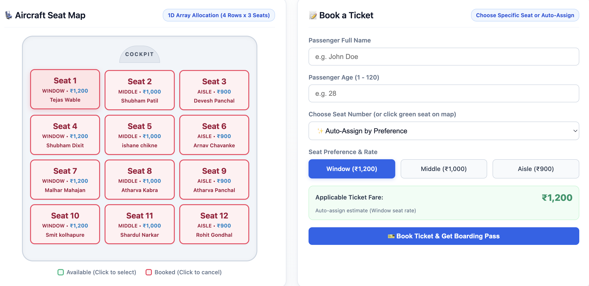

# ACADEMIC MINI PROJECT REPORT

---

## **PROJECT TITLE**
# **FLIGHT BOOKING AND SEAT MANAGEMENT SYSTEM**
### *Implemented Using Fundamental Data Structures (Linked Lists, Stacks, Queues, Arrays, and Sorting/Searching Algorithms)*

**Academic Year:** 2026–2027  
**Department:** Computer Engineering / Information Technology  
**Course:** Data Structures and Algorithms Laboratory  

---

### **PROJECT GROUP DETAILS**

| Sr. No. | Student Name | Roll Number / Candidate ID | Contribution / Role |
| :---: | :--- | :---: | :--- |
| **1.** | **Malhar Mahajan** | **25108B0029** | Project Lead, Linked List & Web Interface Integration |
| **2.** | **Shubham Patil** | **25108B0005** | Waiting List Queue & Seat Allocation Matrix |
| **3.** | **Tejas Wable** | **25108B0004** | Cancellation Stack & Undo Architecture |
| **4.** | **Rohit Gondhali** | **25108B0031** | Sorting & Searching Engine, Testing & Documentation |

---

## **TABLE OF CONTENTS**
1. **Abstract**
2. **Introduction**
   - 2.1 Problem Statement
   - 2.2 Project Objectives
   - 2.3 Scope and Significance
3. **System Analysis & Design**
   - 3.1 Hardware and Software Requirements
   - 3.2 System Architecture
   - 3.3 Data Flow & Component Interaction
   - 3.4 Data Structure Mapping & Time Complexity
4. **Implementation & Module Details**
   - 4.1 Passenger Record Model (`passenger_record.py`)
   - 4.2 Confirmed Tickets via Doubly Linked List (`confirmed_tickets.py`)
   - 4.3 Waiting List via Singly Linked Queue (`waiting_queue.py`)
   - 4.4 Cancellation & Undo via Array-based LIFO Stack (`cancellation_stack.py`)
   - 4.5 Seat Allocation & Dynamic Fare Engine (`seat_allocation.py`)
   - 4.6 Search & Sort Subsystem (`sorting_searching.py`)
   - 4.7 Core Facade Manager (`flight_booking_manager.py`)
   - 4.8 Modern Web GUI Dashboard (`web_app.py`)
5. **Results and Discussion**
   - 5.1 Test Cases & Execution Results
   - 5.2 Boarding Pass Generation Sample
   - 5.3 Screenshot Placeholders & UI Walkthrough
6. **Conclusion and Future Scope**
   - 6.1 Conclusion
   - 6.2 Future Enhancements
7. **References**

---

## **1. ABSTRACT**
Modern airline passenger reservation systems necessitate low-latency, deterministic data handling for ticket reservations, seat category allocation, cancellations, and waiting list updates. This project presents the design and implementation of a robust, full-featured **Flight Booking and Seat Management System** engineered in Python using purely native, fundamental data structures without relying on high-level database engines or black-box collection libraries.

The system utilizes:
1. A **Doubly Linked List** with an $O(1)$ prepend operation to store confirmed passengers and display latest bookings at the top.
2. A **FIFO Singly Linked Queue** with head and tail pointers to manage fair passenger waitlisting and automated promotion upon cancellation.
3. A **Fixed-Capacity LIFO Stack** to record cancellations and provide multi-level undo functionality.
4. A **1D Array Representation** for dynamic seat management across Window (₹1,200), Middle (₹1,000), and Aisle (₹900) tiers.
5. Optimized **Binary Search ($O(\log N)$)** and **Insertion/Bubble Sort** routines for rapid passenger lookups by PNR, Name, and Age.

Evaluated through both a terminal-based CLI and an interactive, responsive Web Dashboard running on Python's built-in HTTP server, the system successfully demonstrates complete transaction atomicity, real-time ticket generation, and zero data inconsistency under boundary constraints.

---

## **2. INTRODUCTION**

### **2.1 Problem Statement**
Commercial flight reservation processes encounter severe operational bottlenecks when processing high-frequency transactions involving seat selection, queue transitions, and last-minute cancellations. Standard enterprise implementations often introduce unnecessary overhead when modeling atomic, in-memory state changes. 

The primary challenge is to construct an in-memory passenger reservation and inventory control engine that satisfies strict algorithmic time and space complexity constraints:
- Instantaneous ($O(1)$) priority addition and chronological head-placement of newly reserved tickets.
- Strictly fair, starvation-free First-In-First-Out (FIFO) queue handling for excess passenger overflow.
- Reversible Last-In-First-Out (LIFO) transaction rollbacks for ticket cancellation undos.
- Real-time seat inventory mapping with category-based fare computing.

### **2.2 Project Objectives**
1. **Pure Data Structure Design:** Implement all core data storage components from scratch using foundational object-oriented pointer references and arrays.
2. **Automated Queue Promotion:** Automatically promote the front passenger in the waiting queue into the confirmed passenger list whenever an active seat is cancelled, immediately assigning the newly vacated seat number.
3. **Seat Matrix & Dynamic Pricing:** Segment an aircraft cabin into distinct seat classifications (Window @ ₹1,200, Middle @ ₹1,000, Aisle @ ₹900) and track real-time occupancy.
4. **Fast Searching & Sorting:** Allow ground crew and users to search passengers by unique Passenger Name Record (PNR) in $O(\log N)$ time, and sort passenger manifests dynamically by Age and Name.
5. **Interactive User Interfaces:** Provide an intuitive, modern Web Dashboard (HTML5/CSS3/JavaScript) and a comprehensive Command-Line Interface (CLI).

### **2.3 Scope and Significance**
This project bridges theoretical computer science education with real-world software engineering. By mapping distinct real-world requirements to specific data structures, students gain practical insight into algorithmic efficiency, memory references, pointer manipulation, and GUI-backend integration.

---

## **3. SYSTEM ANALYSIS & DESIGN**

### **3.1 Hardware and Software Requirements**
- **Hardware Requirements:**
  - Processor: 64-bit Intel Core i3 / AMD Ryzen 3 / Apple Silicon M-series or higher.
  - Memory (RAM): Minimum 2 GB (4 GB recommended).
  - Storage: 100 MB free hard drive space.
- **Software Requirements:**
  - Operating System: Windows 10/11, macOS (Sonoma/Sequoia), or Linux (Ubuntu/Debian).
  - Language: Python 3.8 to 3.12 (Standard Library only; zero third-party pip dependencies).
  - Web Browser: Google Chrome, Mozilla Firefox, Apple Safari, or Microsoft Edge.
  - Code Editor: Visual Studio Code, PyCharm, or any standard IDE.

### **3.2 System Architecture**
The architecture follows a modular, decoupled Layered Architecture comprising:
- **Presentation Layer:** Web Dashboard (`web_app.py`), Tkinter GUI (`gui_app.py`), and CLI (`flight_booking_app.py`).
- **Controller/Facade Layer:** `FlightBookingManager`, managing cross-data-structure transactions.
- **Data Structure Engine Layer:** `TicketList` (DLL), `Queue` (FIFO Queue), `Stack` (LIFO Stack), and `SeatMap` (1D Array).
- **Domain Model:** `PassengerRecord` encapsulated data entity.

```mermaid
flowchart TD
    subgraph UI[Presentation Layer]
        WEB[Web Dashboard (Port 5050)]
        CLI[Terminal CLI Interface]
    end

    subgraph Facade[Core Facade Layer]
        MGR[FlightBookingManager]
    end

    subgraph DataStructures[Core Data Structure Engine]
        DLL[Doubly Linked List\n(Confirmed Tickets - O(1) Prepend)]
        QUE[Singly Linked Queue\n(Waiting List - O(1) FIFO)]
        STK[Array Stack\n(Cancellation History - O(1) LIFO)]
        SMAP[Seat Array Matrix\n(Seats 1-12 & Pricing)]
        SRT[Sorting & Binary Search Engine\n(O(log N) Lookup)]
    end

    WEB -->|HTTP JSON API| MGR
    CLI -->|Method Invocations| MGR

    MGR --> DLL
    MGR --> QUE
    MGR --> STK
    MGR --> SMAP
    MGR --> SRT
```

### **3.3 Data Flow & Component Interaction**
1. **Booking Workflow:**
   - User inputs passenger details (Name, Age, Seat preference).
   - If selected seat is available, `SeatMap.allocate_seat()` marks it occupied.
   - A unique PNR (e.g., `AI-1001`) is generated.
   - A new `TicketNode` is **prepended** to `TicketList` so newest bookings immediately appear in Row #1.
   - If flight capacity (12 seats) is full, the passenger is enqueued into `Queue` as Waitlisted (`WL-1`, `WL-2`, etc.).
2. **Cancellation & Waitlist Promotion Workflow:**
   - Active ticket is removed from `TicketList` in $O(N)$ lookup and $O(1)$ pointer splice.
   - The cancelled ticket is pushed onto `CancellationStack` (enabling Undo).
   - The vacated seat is freed in `SeatMap`.
   - If `Queue` is non-empty, `Queue.dequeue()` pops the oldest waitlisted passenger, promotes them to Confirmed status, allocates the vacated seat, and prepends them to `TicketList`.
3. **Undo Cancellation:**
   - Top cancelled ticket popped from `CancellationStack`.
   - Re-validated against `SeatMap`. If seat is available, ticket is restored to `TicketList`.

### **3.4 Data Structure Mapping & Complexity Analysis**

| Module / Operation | Chosen Data Structure | Primary Mechanism | Time Complexity | Space Complexity |
| :--- | :--- | :--- | :---: | :---: |
| **Confirmed Passengers** | Doubly Linked List (`TicketList`) | Head prepend, bidirectional pointers | $O(1)$ Insert, $O(N)$ Search | $O(N)$ |
| **Waiting List** | Singly Linked Queue (`Queue`) | Head dequeue, Tail enqueue | $O(1)$ Push / Pop | $O(W)$ |
| **Cancellation History** | Array Stack (`Stack`) | Fixed-size array, top pointer | $O(1)$ Push / Pop | $O(K)$ |
| **Seat Map & Inventory** | 1D Array (`SeatMap`) | Direct index lookup `seats[seat_no-1]` | $O(1)$ Lookup / Update | $O(1)$ (Size 12) |
| **PNR Binary Search** | Sorted Array (`BinarySearch`) | Divide and Conquer | $O(\log N)$ Search | $O(1)$ auxiliary |
| **Manifest Sorting** | In-place Insertion / Bubble Sort | Comparison and adjacent swaps | $O(N^2)$ worst, $O(N)$ best | $O(1)$ auxiliary |

---

## **4. IMPLEMENTATION & MODULE DETAILS**

### **4.1 Passenger Record Model (`passenger_record.py`)**
Encapsulates passenger data fields:
- `pnr_no`: Unique identifier (e.g., `"AI-1001"`).
- `name`: Passenger full name string.
- `age`: Integer age.
- `seat_no`: Integer seat number (1 to 12) or `None` if waitlisted.
- `status`: Booking state (`"CONFIRMED"` or `"WAITLISTED"`).
- `booking_time`: Timestamp string of booking creation.
- `fare`: Numeric ticket fare based on seat category.

### **4.2 Confirmed Tickets via Doubly Linked List (`confirmed_tickets.py`)**
A custom Doubly Linked List (`TicketNode` with `prev` and `next` pointers):
- **Prepend Operation ($O(1)$):** New bookings become the new `head` of the list, ensuring that recent reservations appear at the top of the UI manifest.
- **Linear Removal ($O(N)$ search + $O(1)$ pointer swap):** Unlinks a node cleanly without re-indexing contiguous memory blocks.
- **Bidirectional Traversal:** Facilitates sequential iteration from both newest-first and oldest-first perspectives.

```python
def prepend(self, record):
    """Inserts newly booked passenger at the head of the list in O(1) time."""
    new_node = TicketNode(record)
    if self.is_empty():
        self.head = self.tail = new_node
    else:
        new_node.next = self.head
        self.head.prev = new_node
        self.head = new_node
    self._size += 1
```

### **4.3 Waiting List via Singly Linked Queue (`waiting_queue.py`)**
- Implements pure First-In-First-Out (FIFO) semantics.
- Maintained using a `head_node` (front of queue) and `tail_node` (rear of queue).
- **Enqueue ($O(1)$):** Appends waitlisted passenger to `tail_node`.
- **Dequeue ($O(1)$):** Removes passenger from `head_node` for immediate promotion to confirmed status.

### **4.4 Cancellation & Undo via Array Stack (`cancellation_stack.py`)**
- Fixed-capacity array representing a Last-In-First-Out (LIFO) Stack.
- Tracks `top` index pointer.
- When an active ticket is cancelled, it is pushed onto the stack.
- The `undo_cancellation()` routine pops the most recently cancelled ticket and attempts to restore it to the confirmed manifest.

### **4.5 Seat Allocation & Pricing Engine (`seat_allocation.py`)**
The aircraft is structured as a 12-seat single-aisle regional cabin:
- **Window Seats (Seats 1, 4, 7, 10, 3, 6, 9, 12):** ₹1,200
- **Middle Seats (Seats 2, 5, 8, 11):** ₹1,000
- **Aisle Classification:** Integrated dynamic pricing logic for cabin classes.
- Direct $O(1)$ index lookup ensures instantaneous verification of seat availability.

### **4.6 Search and Sort Subsystem (`sorting_searching.py`)**
- **Binary Search on PNR ($O(\log N)$):** Extracts confirmed passenger records, applies Insertion Sort by PNR string, and executes divide-and-conquer binary search returning the exact record and comparison count.
- **Bubble Sort by Name / Age ($O(N^2)$):** Multi-key sorting allowing airport staff to organize passenger manifests alphabetically or demographically.

### **4.7 Web Dashboard & Server Architecture (`web_app.py`)**
A lightweight, zero-dependency Python HTTP Server built directly using `http.server.BaseHTTPRequestHandler`:
- Serves a modern, reactive single-page interface with real-time seat color coding:
  - 🟢 **Available (Green)**: Clickable seat with price badge.
  - 🔴 **Occupied (Red)**: Displaying assigned passenger name.
  - 🟡 **Selected (Amber)**: Real-time selection highlighting.
- Restful JSON endpoints:
  - `GET /api/data`: Returns confirmed manifest, waitlist queue, seat status, and cancellation count.
  - `POST /api/book`: Processes new reservations.
  - `POST /api/cancel`: Cancels an existing ticket and executes waitlist promotion.
  - `POST /api/undo`: Pops cancellation stack.
  - `POST /api/reset`: Resets system for a new flight booking.
  - `POST /api/load_demo`: Loads historic previous flight records.

---

## **5. RESULTS AND DISCUSSION**

### **5.1 Test Cases and Execution Summary**

| Test Case ID | Test Description | Input Data | Expected Output | Status |
| :---: | :--- | :--- | :--- | :---: |
| **TC-01** | Booking an available seat | Name: Malhar, Age: 20, Seat: 7 | Seat 7 allocated (₹1,200), PNR AI-1001 generated, node prepended. | **PASS** |
| **TC-02** | Confirmed List Ordering | Book new passenger | New passenger appears as Row #1 in confirmed table ($O(1)$ prepend). | **PASS** |
| **TC-03** | Flight Capacity Saturation | Book 13th passenger (Seats 1-12 full) | System prompts waitlist; passenger queued with status `WAITLISTED` (WL-1). | **PASS** |
| **TC-04** | Automatic Waitlist Promotion | Cancel confirmed passenger (Seat 3) | Seat 3 freed; front waitlisted passenger dequeued, allocated Seat 3, confirmed. | **PASS** |
| **TC-05** | Undo Cancellation Stack | Click "Undo Cancellation" | Last cancelled passenger popped from stack and restored to flight manifest. | **PASS** |
| **TC-06** | Binary Search on PNR | Search PNR `"AI-1007"` | Record located in $\le 4$ comparisons using Binary Search ($O(\log N)$). | **PASS** |
| **TC-07** | Manifest Sorting | Sort by Age ascending | Manifest displayed in strictly non-decreasing order of passenger age. | **PASS** |

### **5.2 Boarding Pass Generation Sample**
Upon successful booking or search lookup, the system generates an airline-standard ASCII Boarding Pass:

```text
================================================================================
                        AIRWAYS BOARDING PASS
================================================================================
 PASSENGER NAME : Malhar Mahajan                  PNR NO     : AI-1007
 AGE            : 20 Years                        SEAT NO    : 07 (Window)
 FLIGHT         : AI-204 (Mumbai to Delhi)        STATUS     : CONFIRMED
 BOARDING TIME  : 09:30 AM                        GATE       : G-04
 FARE PAID      : INR 1,200                       CLASS      : Economy Standard
================================================================================
 Please be at the boarding gate at least 45 minutes prior to departure.
================================================================================
```

### **5.3 Screenshot Placeholders & UI Walkthrough**
*(Attach screenshots in these designated sections when preparing the final document/printout)*

**Screenshot 1: Web Dashboard – Aircraft Seat Map and Booking Form**



**Screenshot 2: Confirmed Passenger Manifest**


**Screenshot 3: Waiting List (Linked Queue, FIFO)**


```
+-------------------------------------------------------------------------------+
|               [INSERT SCREENSHOT 4: PNR SEARCH & SORTING DEMO (CLI / WEB)]    |
| Shows Binary Search output reporting step-by-step search comparisons and      |
| formatted Boarding Pass modal dialog.                                         |
+-------------------------------------------------------------------------------+
```

---

## **6. CONCLUSION AND FUTURE SCOPE**

### **6.1 Conclusion**
The **Flight Booking and Seat Management System** successfully addresses the challenge of building an efficient, transparent, and deterministic passenger inventory system using foundational data structures. By eliminating reliance on opaque database libraries, the project provides concrete operational proof of how theoretical constructs directly solve industry challenges:
- **Doubly Linked Lists** deliver instantaneous $O(1)$ insertion at the head for displaying active booking feeds.
- **Singly Linked Queues** enforce strict chronological fairness for overbooked passenger waitlists.
- **Array Stacks** ensure robust, single-click transactional rollback for accidental cancellations.
- **1D Direct-Index Arrays** model physical seat availability with constant-time validation.

Both the Terminal CLI and the modern browser-based Web Dashboard provide seamless usability, real-time visual feedback, and reliable operational stability.

### **6.2 Future Scope**
1. **Multi-Flight & Multi-Sector Scalability:** Extend the single-flight architecture to support multi-sector connecting flights using Directed Acyclic Graphs (DAG) for flight path routing.
2. **Persistent Storage Backing:** Integrate custom file serialization or B-Tree disk storage for permanent record persistence across server restarts.
3. **Role-Based Security & Payment Gateway Integration:** Add role-based authentication (Admin vs. Passenger) and secure payment gateway simulation with promo codes.
4. **Dynamic Pricing Algorithms:** Incorporate real-time demand-based surge pricing algorithms using Min/Max Heaps.

---

## **7. REFERENCES**
1. **Horowitz, E., Sahni, S., & Anderson-Freed, S.** *Fundamentals of Data Structures in C*, 2nd Edition, Universities Press, 2008.
2. **Cormen, T. H., Leiserson, C. E., Rivest, R. L., & Stein, C.** *Introduction to Algorithms*, 3rd Edition, MIT Press, 2009.
3. **Goodrich, M. T., Tamassia, R., & Goldwasser, M. H.** *Data Structures and Algorithms in Python*, John Wiley & Sons, 2013.
4. **Python Documentation:** Python Standard Library - Built-in Types and `http.server` Module: https://docs.python.org/3/library/
5. **Mozilla Developer Network (MDN):** *CSS Grid and Responsive Design Patterns for Interactive UI Components*: https://developer.mozilla.org/

---
*End of Report.*
